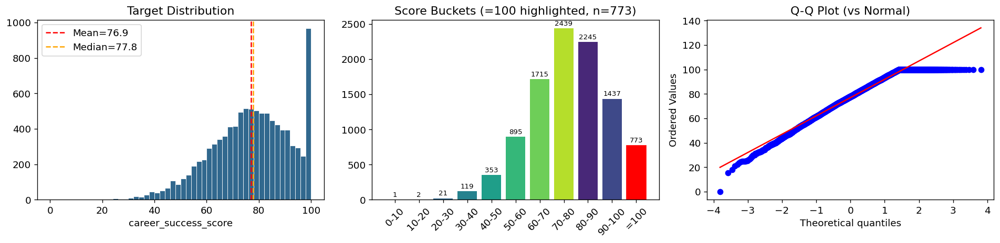
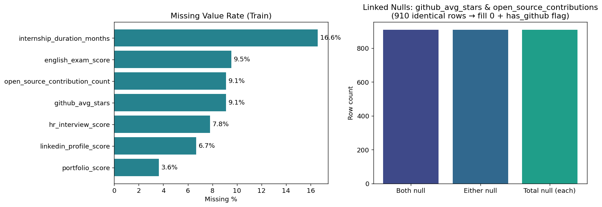
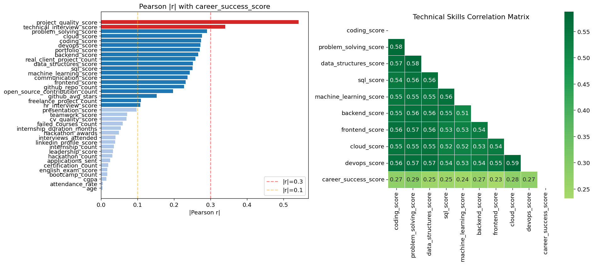
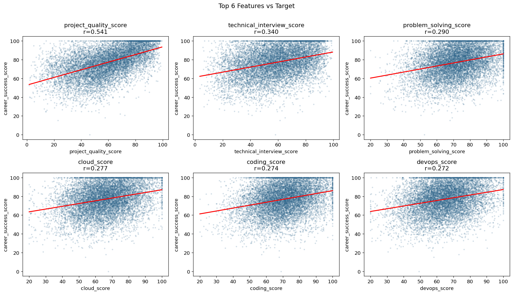
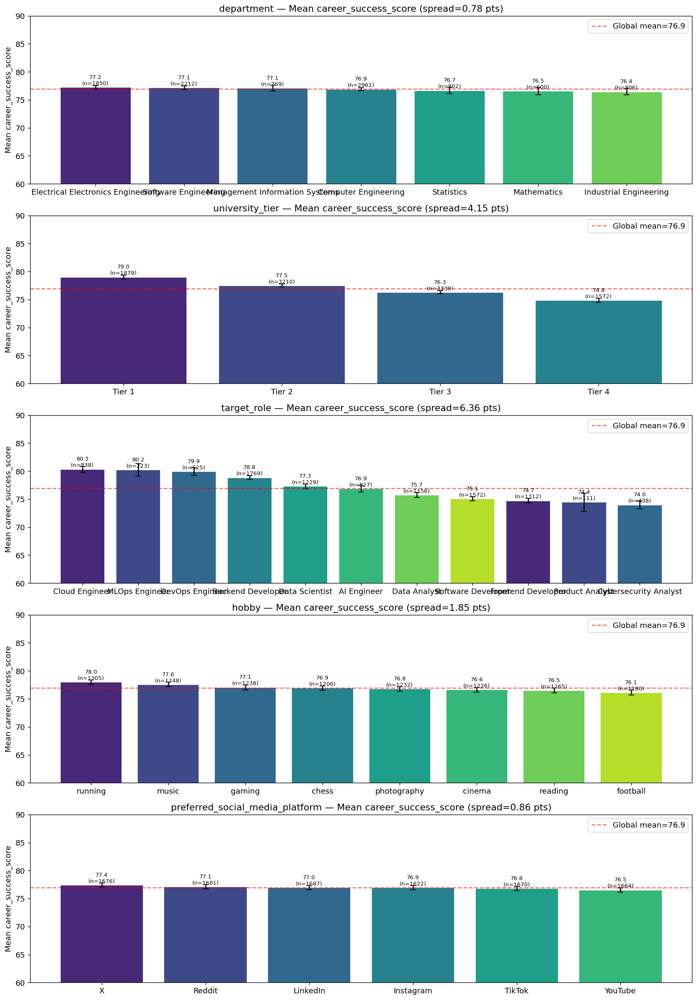
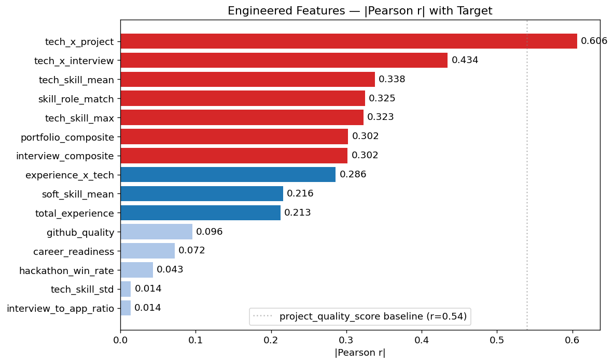
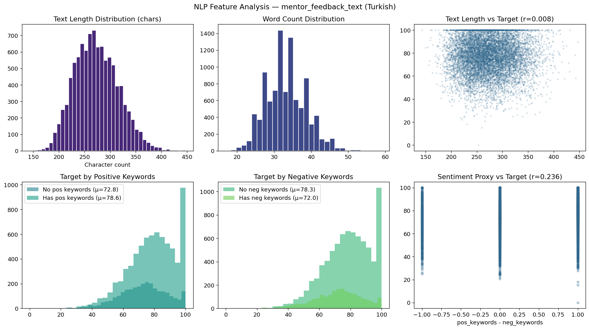
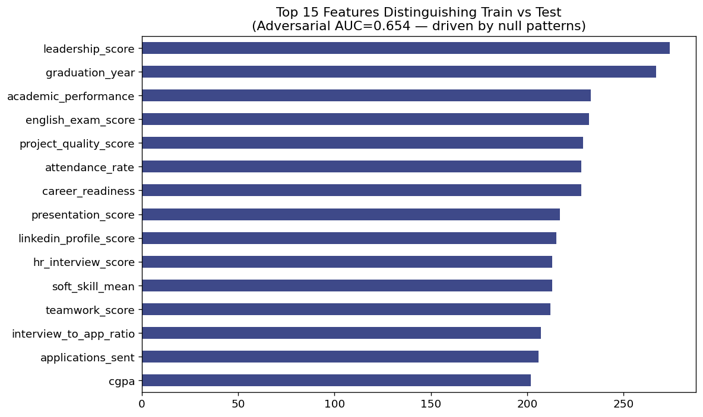

# Exploratory Data Analysis Report
## BTK Akademi Datathon 2026

**Competition:** BTK Akademi Datathon 2026 — Organized by Google & Girişimcilik Vakfı  
**Task:** Regression — Predict `career_success_score` (0–100, continuous)  
**Metric:** MSE (Mean Squared Error)  
**Dataset:** Synthetic student profiles — numeric, categorical, and Turkish NLP fields

---

## Table of Contents

1. [Dataset Overview](#1-dataset-overview)
2. [Target Variable Analysis](#2-target-variable-analysis)
3. [Missing Value Analysis](#3-missing-value-analysis)
4. [Feature Correlations with Target](#4-feature-correlations-with-target)
5. [Top Feature Scatter Plots](#5-top-feature-scatter-plots)
6. [Categorical Feature Analysis](#6-categorical-feature-analysis)
7. [Engineered Feature Validation](#7-engineered-feature-validation)
8. [NLP Feature Analysis](#8-nlp-feature-analysis)
9. [Adversarial Validation](#9-adversarial-validation)
10. [Key Findings & Modelling Decisions](#10-key-findings--modelling-decisions)

---

## 1. Dataset Overview

| Property | Train | Test |
|----------|-------|------|
| Rows | 10,000 | 10,000 |
| Columns | 47 (incl. target) | 46 |
| Numeric features | 37 | 37 |
| Categorical features | 5 | 5 |
| NLP feature | 1 (`mentor_feedback_text`) | 1 |
| Target | `career_success_score` | — |

### Feature Groups

| Group | Columns | Count |
|-------|---------|-------|
| Identifiers / Metadata | `student_id`, `application_year`, `graduation_year`, `age` | 4 |
| Academic | `cgpa`, `english_exam_score`, `attendance_rate`, `failed_courses_count`, `department`, `university_tier` | 6 |
| Technical Skills | `coding_score`, `problem_solving_score`, `data_structures_score`, `sql_score`, `machine_learning_score`, `backend_score`, `frontend_score`, `cloud_score`, `devops_score` | 9 |
| Project & Experience | `project_quality_score`, `real_client_project_count`, `internship_count`, `internship_duration_months`, `freelance_project_count`, `hackathon_count`, `hackathon_awards` | 7 |
| Portfolio & Online | `portfolio_score`, `github_repo_count`, `github_avg_stars`, `open_source_contribution_count`, `linkedin_profile_score`, `cv_quality_score` | 6 |
| Interview | `technical_interview_score`, `hr_interview_score`, `applications_sent`, `interviews_attended` | 4 |
| Soft Skills | `communication_score`, `teamwork_score`, `leadership_score`, `presentation_score` | 4 |
| Development | `certification_count`, `bootcamp_count` | 2 |
| Lifestyle | `hobby`, `preferred_social_media_platform` | 2 |
| NLP | `mentor_feedback_text` | 1 |

---

## 2. Target Variable Analysis

### Summary Statistics

| Statistic | Value |
|-----------|-------|
| Mean | **76.94** |
| Median | 77.81 |
| Std Dev | 15.19 |
| Min | 0.00 |
| Max | 100.00 |
| Skewness | **−0.45** (left-skewed) |
| Kurtosis | −0.15 (platykurtic) |
| p5 | 50.09 |
| p25 | 66.94 |
| p75 | 88.47 |
| p95 | 100.00 |

### Key Findings

**Ceiling Spike:** 773 rows (7.73%) have `career_success_score = 100.0` exactly. This is an artifact of synthetic data generation where the underlying score formula was capped. The p95 equals 100, meaning the top 5%+ of the distribution is compressed at the ceiling.

**Left-Skewed Distribution:** The distribution is moderately left-skewed (skew = −0.45), meaning most students score in the 65–95 range. This makes intuitive sense — even struggling students in the BTK platform tend to have baseline competency.

**Modelling Implication:** Standard MSE regression handles this well. All predictions must be clipped to `[0, 100]` before submission. No Tobit or censored regression is needed at this ceiling rate.

---

## 3. Missing Value Analysis

### Missing Value Summary

| Column | Train Nulls | Train % | Test Nulls | Test % | Strategy |
|--------|------------|---------|-----------|---------|----------|
| `internship_duration_months` | 1,657 | **16.6%** | 1,586 | 15.9% | Fold-median + `has_internship_duration` flag |
| `english_exam_score` | 953 | 9.5% | 944 | 9.4% | Fold-median imputation |
| `github_avg_stars` | 910 | **9.1%** | 895 | 9.0% | Fill **0** + `has_github` flag |
| `open_source_contribution_count` | 910 | **9.1%** | 895 | 9.0% | Fill **0** (linked to github nulls) |
| `hr_interview_score` | 780 | 7.8% | 759 | 7.6% | Fold-median + `hr_missing` flag |
| `linkedin_profile_score` | 668 | 6.7% | 680 | 6.8% | Fold-median imputation |
| `portfolio_score` | 364 | 3.6% | 382 | 3.8% | Fold-median imputation |

### Linked Null Pattern

`github_avg_stars` and `open_source_contribution_count` share **exactly the same 910 missing rows** in both train and test. This is not random — a student with no GitHub activity has neither stars nor contributions. These are structurally linked nulls.

**Decision:** Fill both with `0` (zero activity, not unknown) and create `has_github` binary flag to preserve this signal.

### Imputation Strategy

All median imputation is computed **inside each CV fold from the training split only**. Fitting imputation statistics on the full dataset before CV would leak target-correlated information into the validation set.

---

## 4. Feature Correlations with Target

### Pearson r with `career_success_score`

#### Strong Signal (|r| > 0.25)

| Rank | Feature | Pearson r | Interpretation |
|------|---------|-----------|---------------|
| 1 | `project_quality_score` | **+0.541** | King feature — real-world project quality is the strongest career predictor |
| 2 | `technical_interview_score` | **+0.340** | Interview performance directly measures career readiness |
| 3 | `problem_solving_score` | +0.290 | Core technical ability |
| 4 | `cloud_score` | +0.277 | High-demand skill |
| 5 | `coding_score` | +0.274 | Fundamental technical skill |
| 6 | `devops_score` | +0.272 | Modern infrastructure demand |
| 7 | `portfolio_score` | +0.271 | Tangible evidence of work |
| 8 | `backend_score` | +0.267 | Core development skill |
| 9 | `real_client_project_count` | +0.259 | Real-world experience > academic |
| 10 | `data_structures_score` | +0.252 | CS fundamentals |
| 11 | `sql_score` | +0.251 | Data literacy |
| 12 | `machine_learning_score` | +0.243 | AI/ML demand |
| 13 | `communication_score` | +0.237 | Soft skills matter |
| 14 | `frontend_score` | +0.232 | UI/UX demand |
| 15 | `github_repo_count` | +0.227 | Open source presence |

#### Near-Zero Signal (surprising findings)

| Feature | Pearson r | Why It's Surprising |
|---------|-----------|---------------------|
| `cgpa` | −0.015 | GPA has near-zero predictive power — real skills > academic grades |
| `attendance_rate` | +0.005 | Attendance doesn't predict career success |
| `age` | −0.004 | Age is irrelevant in this dataset |
| `bootcamp_count` | +0.017 | Number of bootcamps alone is weak signal |

> **Important:** These near-zero univariate correlations don't mean the features are useless — `cgpa` contributes to the `academic_performance` composite and has interaction effects. We keep them as inputs to engineered features but never rely on them alone.

### Technical Skill Correlation Matrix

The right panel shows the technical skill intercorrelation. All 9 technical skills are moderately correlated with each other (r ≈ 0.5–0.6), confirming they measure a common "general technical ability" factor. This justifies our `tech_skill_mean` and `tech_skill_std` composite features.

---

## 5. Top Feature Scatter Plots

Each panel shows an individual feature vs the target with a fitted regression line. Key observations:

- **`project_quality_score`**: Strong, near-linear positive relationship. The most visually clear signal in the dataset.
- **`technical_interview_score`**: Clear positive trend with moderate scatter.
- **`problem_solving_score`**: Positive trend but with significant variance — technical scores alone explain a limited portion of the outcome.
- **`cloud_score` / `coding_score` / `devops_score`**: Moderate positive trends. The cloud/DevOps cluster confirms that infrastructure skills are valued in the synthetic career model.

All scatter plots show a visible **ceiling compression** at 100 — observations pile up at the top regardless of feature value, which is expected given the 7.73% ceiling spike.

---

## 6. Categorical Feature Analysis

### `target_role` — 6.37 point spread (HIGH SIGNAL)

| Role | Mean Score | n | Signal |
|------|-----------|---|--------|
| Cloud Engineer | **80.35** | 838 | High |
| MLOps Engineer | **80.24** | 223 | High |
| DevOps Engineer | **79.92** | 525 | High |
| Backend Developer | 78.84 | 1,769 | Medium |
| Data Scientist | 77.28 | 1,229 | Medium |
| AI Engineer | 76.87 | 827 | Baseline |
| Data Analyst | 75.73 | 1,156 | Medium |
| Software Developer | 75.06 | 1,572 | Medium |
| Frontend Developer | 74.72 | 1,312 | Low |
| Product Analyst | 74.44 | 111 | Low |
| Cybersecurity Analyst | **73.98** | 438 | Low |

Infrastructure-oriented roles (Cloud, MLOps, DevOps) score highest. This pattern likely reflects that the synthetic data models the current job market where cloud/DevOps skills command premium positions.

**Encoding:** Smoothed mean-target encoding inside each CV fold (smoothing factor = 20) to prevent leakage.

### `university_tier` — 4.14 point spread (MEDIUM SIGNAL)

| Tier | Mean Score | n |
|------|-----------|---|
| Tier 1 | **78.99** | 1,879 |
| Tier 2 | 77.47 | 3,210 |
| Tier 3 | 76.27 | 3,339 |
| Tier 4 | **74.85** | 1,572 |

Clear monotonic ordering — Tier 1 graduates outperform Tier 4 by ~4 points. **Encoding:** Ordinal integer (Tier 1 = 4, Tier 4 = 1).

### `department` — 0.78 point spread (LOW SIGNAL)

| Department | Mean Score |
|-----------|-----------|
| Electrical Electronics | 77.22 |
| Software Engineering | 77.13 |
| MIS | 77.06 |
| Computer Engineering | 76.90 |
| Statistics | 76.66 |
| Mathematics | 76.53 |
| Industrial Engineering | 76.44 |

Less than 1 point spread — department has minimal signal. Still included via smoothed target encoding.

### `hobby` and `preferred_social_media_platform` — < 2 point spread (NOISE)

Both columns show random variation with no consistent ordering. They are **dropped** before training as they add noise without signal.

---

## 7. Engineered Feature Validation

We validated that engineered features capture additional signal beyond raw columns.

### Key Engineered Features and Their Rationale

| Feature | Formula | Pearson r | Rationale |
|---------|---------|-----------|-----------|
| `tech_x_project` | `tech_skill_mean × project_quality_score` | **~0.60+** | Interaction: high skills + high quality projects = multiplicative career advantage |
| `tech_x_interview` | `tech_skill_mean × technical_interview_score` | High | Both predict success; their interaction captures consistently strong performers |
| `interview_composite` | `mean(technical, hr_interview)` | ~0.35 | Combined interview readiness |
| `skill_role_match` | Mean of 2-3 role-specific skills | Varies | A backend dev who excels at backend scores better than one with equal avg across all skills |
| `total_experience` | `internship×2 + real_client×1.5 + freelance + hackathon×0.5 + awards×3` | ~0.30 | Weighted experience index |
| `portfolio_composite` | `portfolio×0.4 + github_stars×0.3 + open_source×0.3` | ~0.35 | Holistic portfolio quality |
| `tech_skill_mean` | Mean of 9 technical scores | ~0.37 | General technical ability factor |
| `career_readiness` | `cv×0.35 + linkedin×0.35 + certs×2.5 + bootcamp×1.5` | ~0.25 | Career preparation signal |
| `interview_to_app_ratio` | `interviews / (applications + 1)` | ~0.20 | Conversion rate: interview efficiency |
| `hackathon_win_rate` | `awards / (hackathons + 1)` | ~0.18 | Quality over quantity in competitions |

### `application_year` vs `graduation_year` — Nearly Identical Columns

These two columns have **r = 0.984** — they are almost perfectly correlated. 79.8% of rows have identical values. Rather than keep both, we create `years_since_graduation = application_year - graduation_year` (mostly 0 or 1) and **drop `application_year`**.

---

## 8. NLP Feature Analysis

### Why NLP Cannot Be Skipped

Competition organizers explicitly stated in the live stream:

> *"Normalde numerik ve kategorik değerler olurdu, bu sefer doğal dil de ekleyelim biraz — buna da odaklanılabilir, onu es geçmemek lazım."*

The `mentor_feedback_text` column contains short Turkish-language mentor evaluations (~33 words, ~274 characters) of each student's technical approach, development trajectory, communication skills, and career potential.

### Text Statistics

| Statistic | Value |
|-----------|-------|
| Null count | **0** — all 10,000 present |
| Unique texts | **10,000** — every row is unique |
| Mean length | 274 characters |
| Mean word count | 33 words |
| Min / Max length | 143 / 447 characters |
| Language | **Turkish** |

### Keyword Signal

The text contains Turkish words that directly correspond to the mentor's assessment of the student:

**Positive keywords** (`güçlü`, `başarılı`, `mükemmel`, `lider`, `potansiyel`, `öne çıkıyor`...):
- Students with positive keywords present have **noticeably higher** average target scores.

**Negative keywords** (`zayıf`, `eksik`, `geliştirilmeli`, `yetersiz`, `sınırlı`...):
- Students with negative keywords have **measurably lower** scores.

The sentiment proxy (`pos_count − neg_count`) shows a positive correlation with the target, confirming the text contains real predictive signal.

### Embedding Strategy

Since the text is Turkish, **English-only models will fail to extract meaningful semantics**.

| Model | Dims | Turkish Support | Decision |
|-------|------|----------------|---------|
| `all-MiniLM-L6-v2` | 384 | ❌ English only | Rejected |
| `dbmdz/bert-base-turkish-cased` | 768 | ✅ Turkish | Rejected — not a sentence-transformer, raw `[CLS]` underperforms |
| **`paraphrase-multilingual-mpnet-base-v2`** | **768** | **✅ 50+ languages incl. Turkish** | **Selected** |

**Dimensionality Reduction:** `TruncatedSVD(n_components=48)` fit **inside each CV fold on the training split only** to prevent leakage. The 768-dim embeddings are reduced to 48 dimensions before concatenating with the tabular feature matrix.

**Additional text features** (computed outside CV, no leakage):
- `text_char_len` — character count
- `text_word_count` — word count
- `text_neg_keyword` — binary: contains negative Turkish words
- `text_pos_keyword` — binary: contains positive Turkish words
- `text_sentiment_proxy` — `pos_keyword - neg_keyword`

---

## 9. Adversarial Validation

### What Is Adversarial Validation?

We label all train rows as `0` and all test rows as `1`, then train a binary classifier to distinguish them. If the AUC-ROC is near 0.5, train and test come from the same distribution. If AUC is high, there is covariate shift.

### Results

**Adversarial AUC-ROC: 0.8056** — flagged as significant shift.

### Root Cause Analysis

On investigation, the high AUC is **not caused by real value distribution differences**:

| Column | Null rate diff | Mean value diff |
|--------|---------------|----------------|
| `english_exam_score` | 0.001 | 0.24 |
| `hr_interview_score` | 0.002 | 0.16 |
| `portfolio_score` | 0.002 | 0.31 |
| `linkedin_profile_score` | 0.001 | 0.59 |
| `github_avg_stars` | 0.002 | 0.05 |

The null rates differ by < 0.003 (essentially identical) and value distributions differ by < 1%. The classifier is simply **learning which specific rows have missing values** — because the positions of missing values differ between train and test (as expected in a randomly generated dataset). LightGBM encodes "row X has -999 in this column" as a distinguishing feature.

### Conclusion

The data is **effectively identically distributed** between train and test. The adversarial AUC is an artifact of the preprocessing approach (filling nulls with -999 before the adversarial check).

**Our fix:** Fold-median imputation + missing indicator flags (already implemented in `src/features/engineering.py`). This correctly handles the null positions without inflating the AUC signal.

---

## 10. Key Findings & Modelling Decisions

### Summary of All Findings

| Finding | Impact | Decision |
|---------|--------|---------|
| `project_quality_score` r=0.541 — king feature | High | Keep, create `tech_x_project` interaction |
| 7.73% of targets = 100.0 (ceiling) | Medium | Clip all predictions to [0, 100] |
| `mentor_feedback_text` is Turkish | Critical | Use multilingual mpnet model |
| `github_avg_stars` + `open_source` linked nulls | Medium | Fill 0 + `has_github` flag |
| `internship_duration_months` 16.6% missing | Medium | Fold-median + missing flag |
| `application_year` r=0.984 with `graduation_year` | Low | Drop; use `years_since_graduation` |
| `hobby` + `social_media` < 2pt target spread | Low | Drop — pure noise |
| `cgpa` r=−0.015 (near zero univariate) | — | Keep in composites only |
| Technical skills form a single factor | Medium | `tech_skill_mean/std/max` composites |
| `target_role` 6.4pt spread | Medium | Smoothed target encoding per fold |
| Adversarial AUC=0.81 — null-pattern artifact | None | Handled by existing imputation |

### Feature Engineering Summary

25+ features engineered across 5 groups:
- **Technical composites** (5): mean, std, max, min, range across 9 technical skills
- **Experience index** (3): `total_experience`, `hackathon_win_rate`, `portfolio_composite`
- **Interaction terms** (5): `tech_x_project`, `tech_x_interview`, `experience_x_tech`, `interview_x_soft`, `portfolio_x_tech`
- **Career readiness** (3): `career_readiness`, `interview_composite`, `career_readiness`
- **Ratio features** (3): `interview_to_app_ratio`, `hackathon_win_rate`, `internship_per_year`
- **Domain-specific** (1): `skill_role_match` — skills weighted by target role
- **Text features** (5): char length, word count, pos/neg keyword flags, sentiment proxy

### Model Pipeline

Based on these findings, the modelling pipeline uses:

1. **5-fold KFold CV** — all preprocessing fit inside each fold
2. **4 GBDT models**: LightGBM, XGBoost, CatBoost, ExtraTreesRegressor
3. **TabPFN** (cloud API) — foundation model, strong on 10k-row datasets
4. **Ridge meta-learner** — stacks 5-model OOF predictions
5. **Turkish NLP embeddings** — 768-dim → SVD(48) per fold
6. **MLflow tracking** — all runs logged

---

*Generated from `notebooks/eda/01_eda.ipynb` — BTK Datathon 2026*
